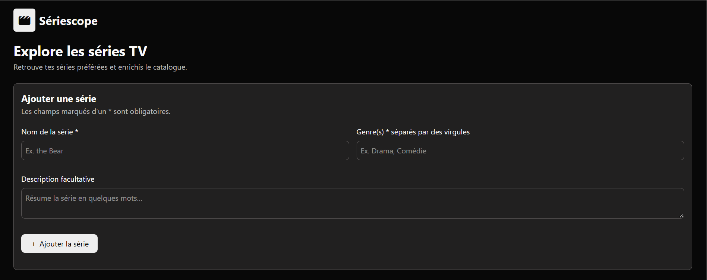
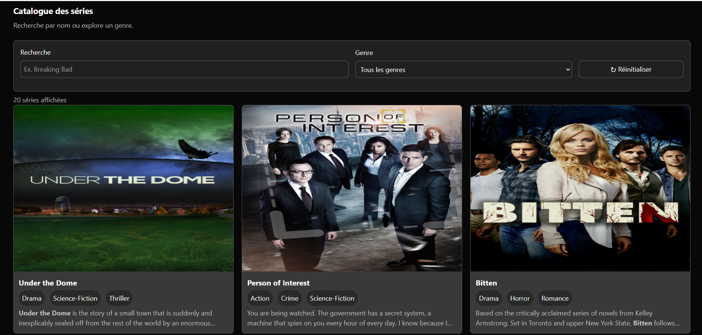
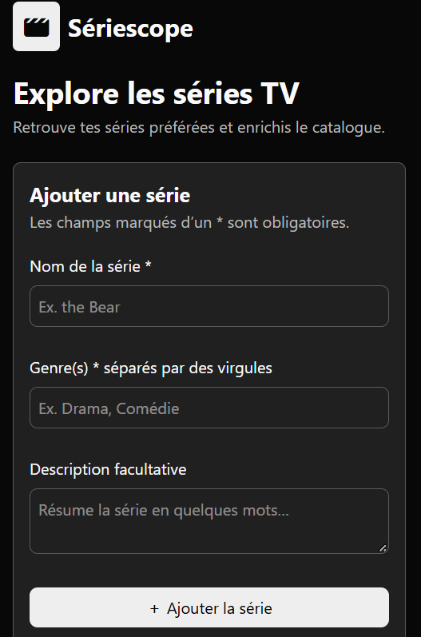
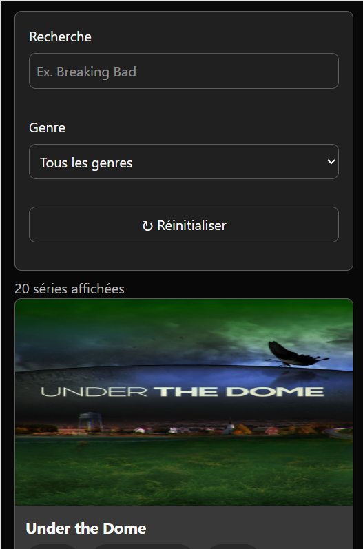
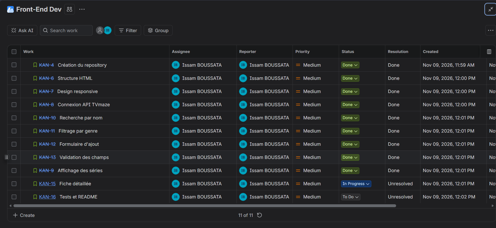

# 🎬 SérieScope

SérieScope est une application web sur une seule page qui présente un catalogue de séries et de documentaires. Les visiteurs peuvent parcourir le catalogue, rechercher une série par son nom et filtrer les titres par genre. Il est aussi possible d'ajouter une nouvelle série depuis l'interface.

Projet réalisé dans le cadre de la formation de développeur web (travail individuel).

## Captures d'écran

### Version desktop




### Version mobile




## Fonctionnalités

- **Catalogue** : affichage des 20 premières séries de l'API sous forme de cartes (affiche, titre, genres, description).
- **Recherche** : recherche par nom, sans distinction entre majuscules et minuscules.
- **Filtre par genre** : liste des genres générée automatiquement à partir du catalogue.
- **Réinitialisation** : bouton qui efface la recherche et le filtre pour rétablir le catalogue complet.
- **Ajout d'une série** : formulaire avec validation des champs obligatoires. La nouvelle série apparaît immédiatement dans le catalogue.
- **Fiche détaillée** : un clic sur une carte affiche les informations de la série sur la même page.

> Les séries ajoutées sont conservées dans un tableau JavaScript : elles disparaissent au rechargement de la page.

## Technologies utilisées

- HTML5
- [Tailwind CSS](https://tailwindcss.com/)
- JavaScript Vanilla (`fetch`, `async/await`, manipulation du DOM)

## API utilisée

Les données proviennent de l'API publique [TVmaze](https://www.tvmaze.com/api) :

```
GET https://api.tvmaze.com/shows
```

Propriétés exploitées : `name`, `genres`, `summary` et `image.original`.

## Structure du projet

```
SérieScope/
├── index.html          # Structure de la page
├── js/
│   └── script.js       # Logique de l'application
├── screenshots/        # Captures d'écran (desktop, mobile, Jira)
├── tailwind.config.js  # Configuration de Tailwind CSS
└── README.md
```

## Lancer le projet

1. Cloner le dépôt :
   ```bash
   git clone https://github.com/issam-boussata/S-rieScope.git
   cd S-rieScope
   ```
2. Ouvrir `index.html` dans un navigateur (ou utiliser l'extension **Live Server** de VS Code).
3. Vérifier que la connexion Internet est active, car le catalogue est chargé depuis l'API TVmaze.

## Organisation du travail

- **GitFlow** : branches `main` et `develop`, avec des branches de fonctionnalités (`feature/layout`, `feature/AfficherFilms`, `feature/filtrer_rechrcher`, `feature/Detail`) intégrées par Pull Requests.
- **Figma** : maquettes desktop et mobile.
- **Jira** : suivi des tâches avec les statuts *À faire*, *En cours*, *En revue* et *Terminé*.

### Tableau Jira

🔗 [Voir le tableau Jira](https://serie-scope.atlassian.net/jira/software/projects/KAN/list?jql=project+%3D+KAN+ORDER+BY+cf%5B10019%5D+ASC&atlOrigin=eyJpIjoiOWEyNzk1MTE2ZTgyNDFmZjkyOGIxZmZmMWE0MmVkODYiLCJwIjoiaiJ9)



## Auteur

Boussata Issam — 2026
